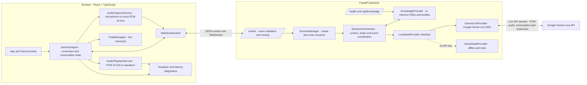

# Gemini Voice Agent Architecture

## System overview

The project uses a React and TypeScript client, a FastAPI backend, and Gemini Live for real-time conversation. Audio, transcripts, and control events travel over one bidirectional WebSocket. The backend keeps a separate provider session for each connected browser client.



## AI model roles

The configured model is **`gemini-3.8-live`**. The same Live model handles text reasoning and native audio interaction; the application does not call separate speech recognition or speech synthesis models.

| Role | Model or component | What it does |
|---|---|---|
| LLM | `gemini-3.8-live` | Understands typed or spoken input, uses session context, and generates the agent response. |
| STT | Gemini Live input audio transcription | Produces input transcript events from microphone audio; enabled in the Live session configuration. |
| TTS / text-to-audio | `gemini-3.8-live` audio output | Generates speech audio as part of the same response; the backend streams its PCM chunks to the browser. |

The model name is configured in `backend/.env` and `backend/config.py`. `backend/providers/gemini_live.py` enables input and output transcription and requests audio responses. `MockModelProvider` is an offline/test substitute, not an STT or TTS model.

## Conversation flows

### Voice input

1. The user starts voice mode. The client connects to `/ws/live`, sends `session.start`, and waits for the backend's `session.ready` before starting microphone capture.
2. `AudioCaptureService` requests microphone access, resamples to mono 16 kHz PCM, converts it to 16-bit little-endian samples, and emits roughly 100 ms chunks.
3. `useVoiceAgent` Base64-encodes each chunk in an `audio.chunk` event. FastAPI validates the event and passes it to the session orchestrator.
4. The orchestrator decodes the PCM and sends it to Gemini Live. Gemini's VAD determines speech turn boundaries; the provider is configured for input and output transcription.
5. Provider events flow back through the orchestrator as `transcript.input`, `transcript.output`, `audio.chunk`, and response lifecycle events. The client updates the transcript and queues 24 kHz PCM for playback.

### Typed input

1. The client sends `text.message` over the same WebSocket.
2. The orchestrator retrieves matching FAQ/profile context and appends it to the prompt when available.
3. The provider sends the prompt to the existing Live session. Transcription, audio, and completion events return through the same event pump.

### Knowledge and operations

- `POST /api/knowledge` adds a document; `GET /api/knowledge` lists the current in-memory documents. This is a lightweight extension point, not a persistent vector database.
- `GET /health` reports backend/model configuration and active session count.
- If no usable API key is configured, `SessionManager` selects the mock provider for local/offline behavior. The mock simulates the event contract; it does not recognize actual speech.
- On disconnect, the session manager closes the provider and cancels its event pump.

## Event path

| Direction | Events | Purpose |
|---|---|---|
| Browser → backend | `session.start`, `audio.chunk`, `audio.end`, `text.message`, `response.interrupt`, `session.stop` | Start a session; stream audio/text; signal turn end, interruption, or shutdown |
| Backend → browser | `session.ready`, `transcript.input`, `transcript.output`, `audio.chunk`, `response.started`, `response.completed`, `session.error`, `session.closed` | Session status, transcript, generated speech, turn metrics, errors, and closure |

## Main implementation map

| Layer | Files |
|---|---|
| React application and controls | `frontend/src/App.tsx`, `frontend/src/components/` |
| Client session and event handling | `frontend/src/hooks/useVoiceAgent.ts`, `frontend/src/services/websocket.ts` |
| Browser audio capture/playback | `frontend/src/services/audioCapture.ts`, `frontend/src/services/audioPlayback.ts` |
| WebSocket API and schemas | `backend/api/websocket.py`, `backend/schemas/events.py` |
| Session lifecycle and orchestration | `backend/core/session_manager.py`, `backend/core/orchestrator.py` |
| AI provider implementations | `backend/providers/gemini_live.py`, `backend/providers/mock_live.py`, `backend/providers/base.py` |
| Knowledge extension | `backend/services/knowledge.py`, `backend/main.py` |

## Runtime topology

```text
Browser (Vite, usually :5173)
  ├─ HTTP → FastAPI (:8000) for health and knowledge endpoints
  └─ WebSocket → ws://<host>:8000/ws/live
                    └─ Gemini Live API (outbound connection from backend)
```

The Gemini API key stays on the backend and is loaded from `backend/.env`; it should not be placed in frontend code.
